# dtbTerminalIO

**Rich terminal UIs in plain Java. No dependencies. No magic.**

[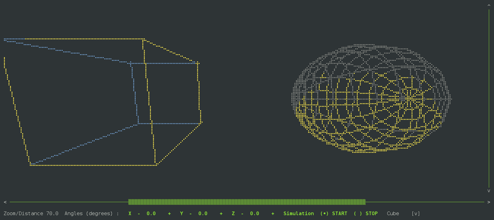](src/main/java/dtb/terminalIO/examples/plot/TestCube.java)

<sub>That is a terminal. Every dot is a braille character - each cell holds 2 x 4 of them - redrawn many
times a second, in plain Java 8. [See the code →](src/main/java/dtb/terminalIO/examples/plot/TestCube.java)</sub>

It started as a few helpers for VT-100 control codes. To say it went a little overboard... well, that
just understates it.

- **Real components** - forms, buttons, lists, dropdowns, menus, tables, trees, tabs, dialogs - with
  keyboard focus that just works.
- **The mouse, properly** - click, drag, and move or resize windows by their corners, right in the terminal.
- **Graphics where you didn't expect them** - plot in your own units, draw shapes that fill, rotate and
  scale, and charts (bar, line, donut, sparkline) that you can click.
- **Live data** - animate at your own pace, follow a stream as it grows; only what changed is redrawn.
- **Nothing to install** - Java 8 or later, zero runtime dependencies, Apache-2.0.

Every picture on this page is a real example in this repository, and each one links to its source.

## Quick start

```java
public class QuickStart {

    public static void main(String[] args) throws IOException {
        new TUIApp(args)
                .setDefaultMainApplicationPanel()
                .setEmptyChar(' ')
                .confirmOnExit()
                .setOnReadyStart((tApp) -> {
                    PlotArea plot = new PlotArea(Colors.BCya, new Dimension.Simple(14, 72))
                            .showing(0, 4 * Math.PI, -1.5, 1.5)                // x from..to, y from..to
                            .axes(true)
                            .axesColor(Colors.BBla)
                            .onDraw((pen) -> pen.function(Math::sin));

                    WindowFrame window = new WindowFrame(Colors.Gre, "Hello, terminal", plot);
                    window.setFooterPanel(plot.navigationControls());          // scaling, zoom, pan
                    tApp.getMainApplicationPanel().add(1, 2, window);
                })
                .start();
    }
}
```

[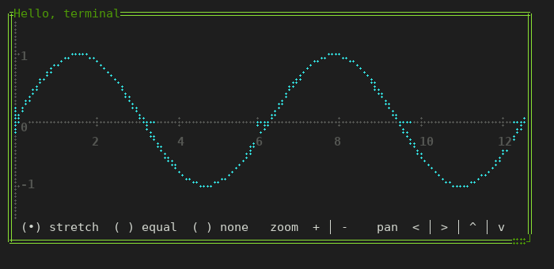](src/main/java/dtb/terminalIO/examples/QuickStart.java)

Drag the window's corner and the plot redraws to fit; the buttons along the bottom zoom and pan:

[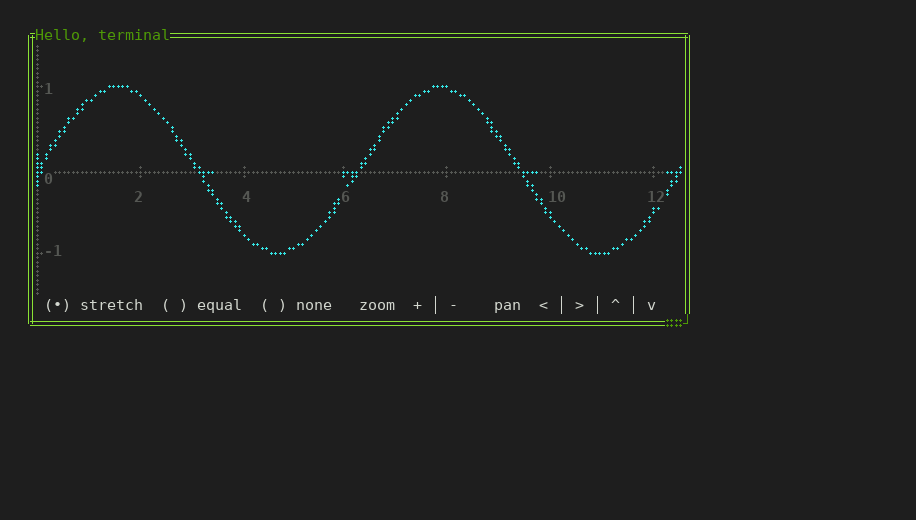](src/main/java/dtb/terminalIO/examples/QuickStart.java)

Build it and run it (Java 8+ and Maven, in a Linux terminal):

```sh
git clone <this repository> && cd dtbTerminalIO
mvn package
java -cp target/classes dtb.terminalIO.examples.QuickStart
```

To use the library in your own project, `mvn install` it and depend on `dtb:dtbTerminalIO:0.1.0`.

## Come for the components

Everything a terminal application needs, with the keyboard and the mouse. One example runs all the
others: pick one in the tree and it runs on the right.

[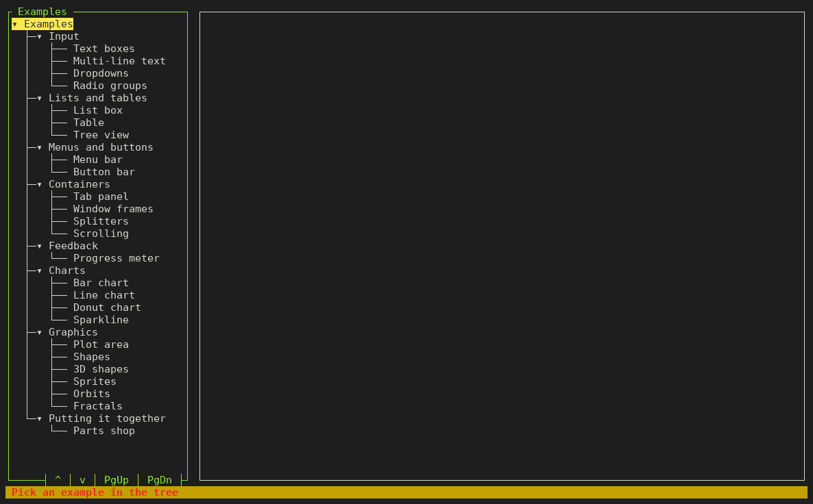](src/main/java/dtb/terminalIO/examples/EmbeddedAppTest.java)

<sub>`java -cp target/classes dtb.terminalIO.examples.EmbeddedAppTest` - each example is its own `main`,
running unchanged inside the desktop. [See the code →](src/main/java/dtb/terminalIO/examples/EmbeddedAppTest.java)</sub>

| | Components | Try it |
|---|---|---|
| **Input** | [TextInput](src/main/java/dtb/terminalIO/components/input/TextInput.java), [MultiLineTextInput](src/main/java/dtb/terminalIO/components/input/MultiLineTextInput.java), [DropdownListBox](src/main/java/dtb/terminalIO/components/input/DropdownListBox.java), [RadioGroup](src/main/java/dtb/terminalIO/components/input/RadioGroup.java), [CheckBoxInput](src/main/java/dtb/terminalIO/components/input/CheckBoxInput.java), [Button](src/main/java/dtb/terminalIO/components/input/Button.java), [FormComponent](src/main/java/dtb/terminalIO/components/input/form/FormComponent.java) (labelled fields with validation, bound to your objects) | [text boxes](src/main/java/dtb/terminalIO/examples/TextBoxSimpleForm01Test.java), [dropdowns](src/main/java/dtb/terminalIO/examples/DropdownListBoxSimpleTest.java), [radio groups](src/main/java/dtb/terminalIO/examples/RadioGroupSimpleTest.java), [a form](src/main/java/dtb/terminalIO/examples/FormComponentTest01.java) |
| **Lists and tables** | [ListBox](src/main/java/dtb/terminalIO/components/input/ListBox.java), [TableComponent](src/main/java/dtb/terminalIO/components/table/TableComponent.java) (bound to your objects, resizable columns), [TreeView](src/main/java/dtb/terminalIO/components/input/tree/TreeView.java) | [list](src/main/java/dtb/terminalIO/examples/ListBoxTest.java), [table](src/main/java/dtb/terminalIO/examples/Table01Test.java), [tree](src/main/java/dtb/terminalIO/examples/TreeViewTest.java) |
| **Menus and buttons** | [MenuBar](src/main/java/dtb/terminalIO/components/menu/MenuBar.java), [ButtonBar](src/main/java/dtb/terminalIO/components/ButtonBar.java) (with hot keys) | [menus](src/main/java/dtb/terminalIO/examples/MenuBarTest.java), [button bar](src/main/java/dtb/terminalIO/examples/ButtonBarTest.java) |
| **Containers** | [TabPanel](src/main/java/dtb/terminalIO/components/tab/TabPanel.java), [WindowFrame](src/main/java/dtb/terminalIO/components/WindowFrame.java) (move and resize with the mouse), [HorizontalSplitter](src/main/java/dtb/terminalIO/components/frameset/HorizontalSplitter.java) / [VerticalSplitter](src/main/java/dtb/terminalIO/components/frameset/VerticalSplitter.java) (draggable dividers), [ScrollableComponent](src/main/java/dtb/terminalIO/components/scroll/ScrollableComponent.java) (with Ctrl-F search), [CollapsiblePanel](src/main/java/dtb/terminalIO/components/CollapsiblePanel.java) | [tabs](src/main/java/dtb/terminalIO/examples/TabPanelTest2.java), [windows](src/main/java/dtb/terminalIO/examples/WindowFrameTest.java), [splitters](src/main/java/dtb/terminalIO/examples/HorizontalSplitterTest.java), [scrolling](src/main/java/dtb/terminalIO/examples/ScrollableComponentTest.java) |
| **Dialogs and feedback** | [MessageBox](src/main/java/dtb/terminalIO/components/modal/MessageBox.java), [DialogComponent](src/main/java/dtb/terminalIO/components/modal/DialogComponent.java), [ProgressMeter](src/main/java/dtb/terminalIO/components/progressmeter/ProgressMeter.java), [StdoutViewer](src/main/java/dtb/terminalIO/components/StdoutViewer.java) (follows a process's output) | [progress](src/main/java/dtb/terminalIO/examples/ProgressMeterTest.java), [stdout](src/main/java/dtb/terminalIO/examples/StdoutViewerTest.java) |
| **Charts** | [BarChart](src/main/java/dtb/terminalIO/components/chart/BarChart.java), [LineChart](src/main/java/dtb/terminalIO/components/chart/LineChart.java), [DonutChart](src/main/java/dtb/terminalIO/components/chart/DonutChart.java), sparklines | [bar](src/main/java/dtb/terminalIO/examples/BarChartTest.java), [line](src/main/java/dtb/terminalIO/examples/LineChartTest.java), [donut](src/main/java/dtb/terminalIO/examples/DonutChartTest.java), [sparkline](src/main/java/dtb/terminalIO/examples/SparklineTest.java) |
| **Graphics** | [PlotArea](src/main/java/dtb/terminalIO/components/plot/PlotArea.java), shapes, sprites, images | [plot](src/main/java/dtb/terminalIO/examples/plot/PlotAreaDemo.java), [shapes](src/main/java/dtb/terminalIO/examples/plot/TestScale.java), [3D](src/main/java/dtb/terminalIO/examples/plot/TestCube.java), [sprites](src/main/java/dtb/terminalIO/examples/plot/TestSprites.java) |

Layout is by rules rather than arithmetic: a pane keeps its size, takes a share of its parent (at least
so many rows), or fills what is left - and the rules run again when the terminal is resized.

## A normal business screen - with pictures

[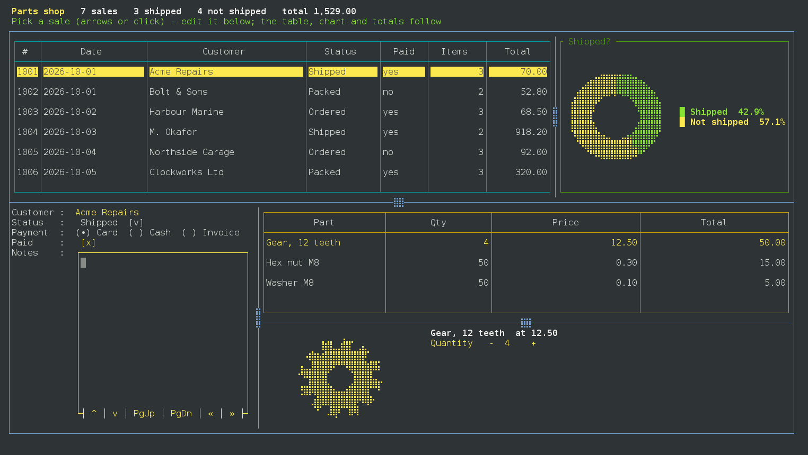](src/main/java/dtb/terminalIO/examples/PartsShopDemo.java)

<sub>Sales in a table, the picked sale in a form, its items in another table - master and detail, bound
to plain Java objects. Pick a sale and the form and items follow; change a quantity and the line, the
sale and the totals follow; mark it shipped and the chart moves. The part you pick is drawn from a
ready-made shape. The dividers drag. [See the code →](src/main/java/dtb/terminalIO/examples/PartsShopDemo.java)</sub>

## ...and stay for the graphics

**Plot in your own numbers** - x to the right, y up; click a shape to find out what it is, drag it,
drag the background to pan.

[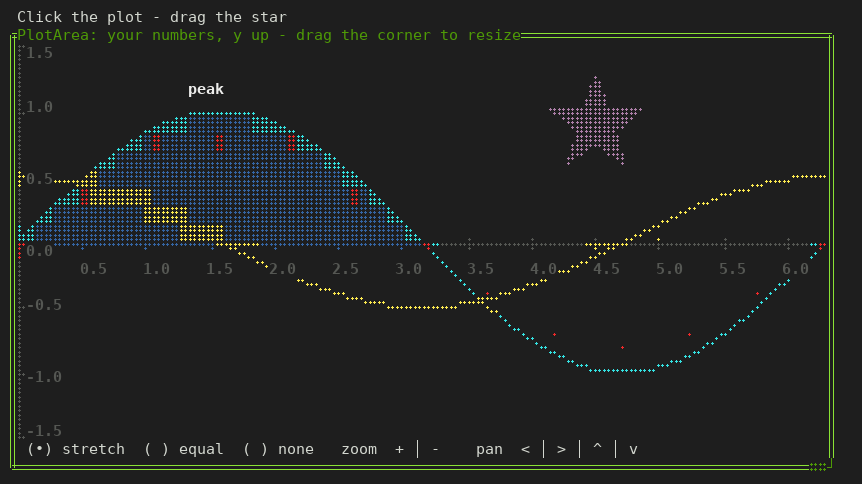](src/main/java/dtb/terminalIO/examples/plot/PlotAreaDemo.java)

<sub>[See the code →](src/main/java/dtb/terminalIO/examples/plot/PlotAreaDemo.java)</sub>

**Shapes** that fill, rotate, scale and move - a catalog of ready-made ones, or your own:

[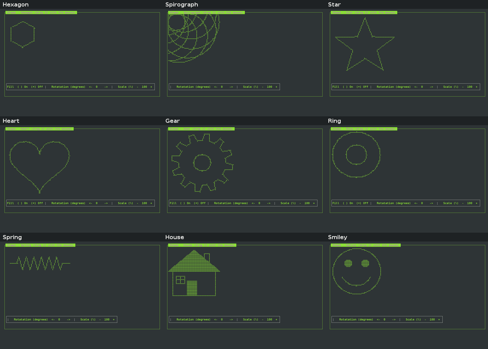](src/main/java/dtb/terminalIO/examples/plot/TestScale.java)

<sub>[See the code →](src/main/java/dtb/terminalIO/examples/plot/TestScale.java)</sub>

**Charts** you can click - or TAB to, and pick with the arrow keys:

| | |
|---|---|
| [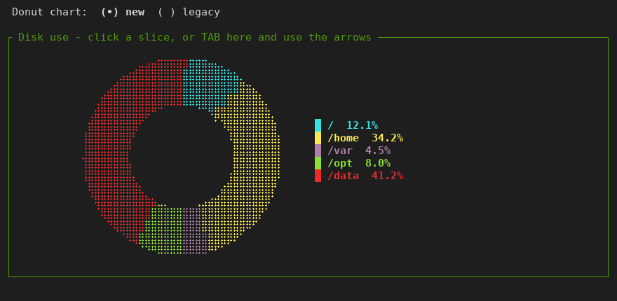](src/main/java/dtb/terminalIO/examples/DonutChartTest.java) | [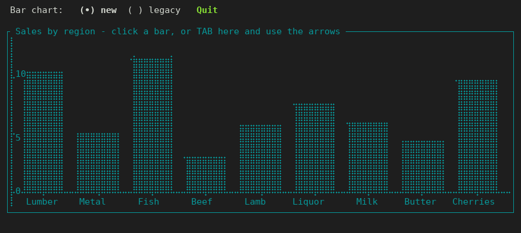](src/main/java/dtb/terminalIO/examples/BarChartTest.java) |
| [Donut chart →](src/main/java/dtb/terminalIO/examples/DonutChartTest.java) | [Bar chart →](src/main/java/dtb/terminalIO/examples/BarChartTest.java) |

Line charts and sparklines too: [LineChartTest](src/main/java/dtb/terminalIO/examples/LineChartTest.java),
[SparklineTest](src/main/java/dtb/terminalIO/examples/SparklineTest.java).

**Images** - PNG, JPEG and GIF, two pixels to a character cell; animated GIFs play:

[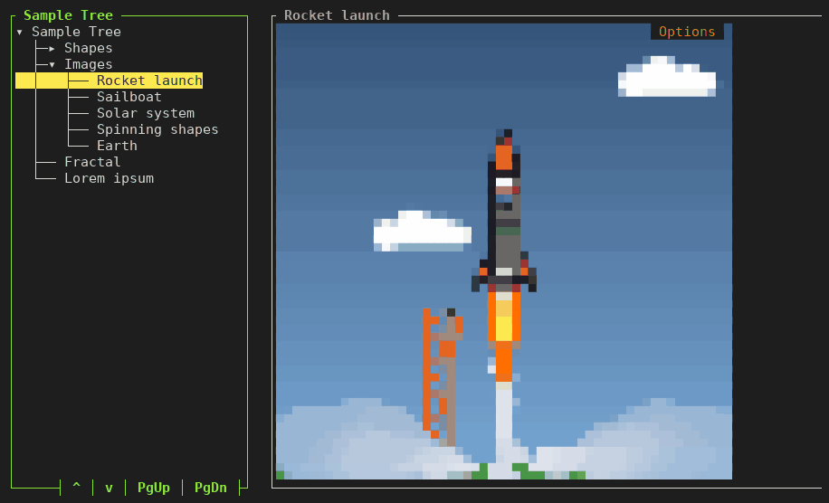](src/main/java/dtb/terminalIO/examples/TreeViewTest.java)

<sub>The rocket, the sailboat and the solar system are drawn in Java by
[DemoImageGenerator](src/main/java/dtb/terminalIO/examples/sampledata/DemoImageGenerator.java); the Earth is a NASA photo
([credits](src/main/resources/dtb/terminalIO/examples/sampledata/images/CREDITS.txt)).
[See the code →](src/main/java/dtb/terminalIO/examples/TreeViewTest.java)</sub>

**Animation** at your own pace:

[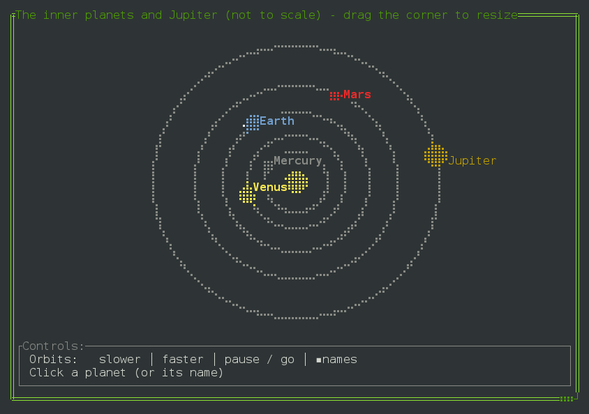](src/main/java/dtb/terminalIO/examples/plot/OrbitsDemo.java)

<sub>[See the code →](src/main/java/dtb/terminalIO/examples/plot/OrbitsDemo.java)</sub>

## Beyond the screen

Draw to a String instead of the terminal - for tests, logs or a command's output. The same shapes, in
braille on the left and in plain characters on the right:

```text
                       ⢀⠔                                                       ./
    ⠐⢄         ⢀⣀⡠⠤⠤⠤⢤⠴⣁⣀                                    .\         ._/---+;__
      ⠑⢄   ⢀⡠⠖⠋⠁   ⢀⠔⠁   ⠉⠓⠦⣀                                  \\   ./r+`   ./`   -*c_
        ⠑⣤⠖⠁     ⢀⠔⠁         ⠑⢦⡀                                 \*r`     ./`         \\.
       ⢀⠜⠁⠑⢄   ⢀⠔⠁             ⠙⢄                               .)`\\   ./`             +\
      ⢠⠎    ⠑⢄⠔⠁                ⠈⢦                             :+    \\/`                '\
     ⢀⠏    ⢀⠔⠁⠑⢄                 ⠈⢇                           .[    ./`\\                 '|
     ⡸   ⢀⠔⠁    ⠑⢄                ⠸⡀                          *   ./`    \\                :.
     ⡇ ⢀⠔⠁        ⠑⢄               ⡇                          | ./`        \\               |
     ⣇⠔⠁            ⠑⢄             ⡇                          L/`            \\             |
    ⠐⢣                ⠑⢄          ⢠⠃                         .\                \\          ::
     ⠘⡄                 ⠑         ⡜                           ::                 \         /
      ⠹⡄                         ⡼⠁                            7:                         j`
       ⠘⢄                      ⢀⠜                               :\                      .)
        ⠈⠳⣄                  ⢀⡴⠋                                 '\c                  ./+
           ⠑⠢⣄⡀           ⣀⡤⠒⠁                                      \\c.           _+-`
              ⠉⠑⠒⠢⠤⠤⠤⠤⠤⠒⠒⠉⠁                                            -\-\--------`
```

<sub>[See the code →](src/main/java/dtb/terminalIO/examples/StringOutputTest.java)</sub>

And `StdoutViewer` follows a process's output as it grows, like `tail -f` in a pane of its own.

## Learn more

- [All the examples](src/main/java/dtb/terminalIO/examples) - each one runs with
  `java -cp target/classes dtb.terminalIO.examples.<Name>`.
- [Architecture notes](docs/ARCHITECTURE.md) - events, focus, and how the pieces fit.
- [Building components](docs/BUILDING-COMPONENTS.md) - making your own.

## Notes

- Pure Java 8. The one outside command it runs is `stty` (through `sh`): for the terminal's size, and
  to switch the keyboard to raw mode and back.
- Mouse support uses the terminal's mouse reporting (xterm style).
- Version 0.1.0: the API may still change before 1.0.

## License

[Apache License 2.0](LICENSE)
